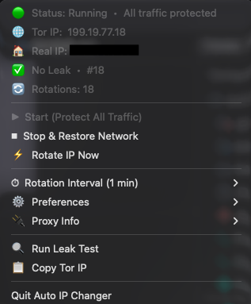

# Auto IP Changer for macOS

<p align="center">
  
</p>

A native macOS menu bar utility that automatically rotates public IP addresses using Tor and manages system-wide proxy settings for privacy.

---

## Preview

<p align="center">
  
</p>

---

## Features

- **Menu Bar Control**: Sits in the macOS top status bar displaying the active IP.
- **Auto IP Rotation**: Periodically cycles Tor circuits (`NEWNYM`) to assign new exit IPs.
- **Configurable Intervals**: Choose from 10s, 30s, 1m, 2m, or 5m rotation intervals.
- **System-Wide SOCKS5 Proxy**: Automatically turns on/off the macOS SOCKS5 proxy on active network interfaces.
- **Leak Detection**: Verifies that your public exit IP differs from your real ISP IP.
- **Native Notifications**: Desktop alerts when a new IP is assigned.
- **Start at Login**: LaunchAgent support to run automatically in the background on system login.

---

## Requirements

- macOS 12+ (Apple Silicon or Intel)
- Python 3.10+
- Tor (`brew install tor`)

---

## Installation

Clone this repository and run the setup script:

```bash
git clone https://github.com/Sherukoda/auto-ip-changer.git
cd auto-ip-changer
bash install.sh
```

---

## Usage

Start the menu bar app:

```bash
~/.tor-ip-changer/launch_menubar.sh
```

Or open `AutoIPChanger.app` from your `~/Applications` folder.

To manage from the command line:

```bash
# Check status
~/.tor-ip-changer/launch_menubar.sh status

# Stop and restore default network settings
~/.tor-ip-changer/launch_menubar.sh stop
```

---

## Uninstallation

To remove the application and restore network settings:

```bash
bash uninstall.sh
```
